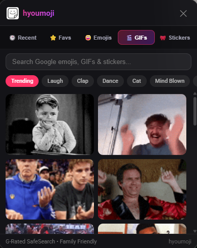
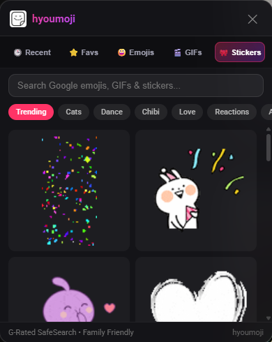
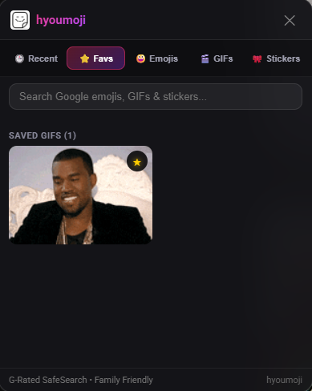
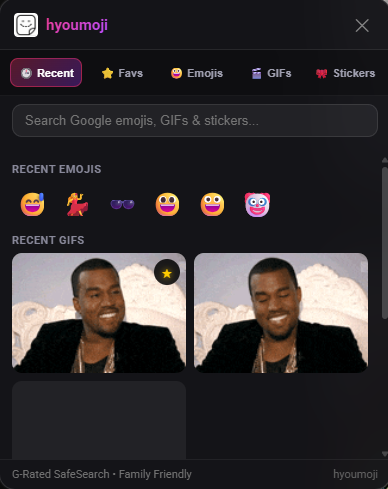
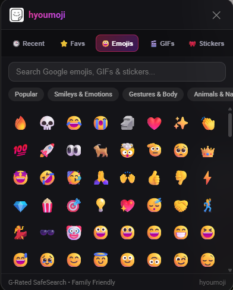

# hyoumoji

A lightweight Chrome extension that brings mobile-style emojis, animated stickers, and GIFs to YouTube comment sections on desktop.

---

## Preview

| Trending GIFs | Animated Stickers |
| :---: | :---: |
|  |  |

| Starred Favorites | Recently Used |
| :---: | :---: |
|  |  |

<p align="center">
  
</p>

---

## Features

* **Clean Comment Box:** Attach GIFs and stickers without raw URLs filling up your typing line.
* **Inline Playback:** Renders animated GIFs and transparent stickers directly inside the YouTube comment feed.
* **Google Noto Emojis:** Full categorized emoji library matching the Android and Google Pixel design system.
* **Favorites & Star:** Star any GIF or sticker in the picker to save it, or click **⭐ Save** on any comment in the feed to save reactions posted by others.
* **Recent Tab:** Automatically tracks your recently used emojis, GIFs, and stickers across sessions.
* **Family Safe:** Strict G-rated filtering enforced on all searches to comply with YouTube Community Guidelines.
* **Zero Bloat & Zero Tracking:** No analytics, no telemetry, no tracking scripts, and no background resource drain.

---

## Installation

1. Clone or download this repository to your PC:
   ```bash
   git clone https://github.com/jack4z1/hyoumoji.git
   ```
2. Open Google Chrome and navigate to:
   ```text
   chrome://extensions
   ```
3. Turn on **Developer mode** in the top-right corner.
4. Click **Load unpacked** in the top-left corner and select the `hyoumoji` folder.
5. Open any video on YouTube, click into the comment box, and click the **hyoumoji** button.

---

## Permissions & Privacy

* `storage`: Used solely on your device to remember your starred favorites and recent items.
* Host permissions are strictly restricted to `youtube.com` (for button injection and inline rendering) and image CDNs (`giphy.com`, `tenor.com`).
* No personal data, cookies, account credentials, or browsing history are ever accessed, stored, or transmitted.

---

## License

[MIT](LICENSE) © [jack4z1](https://github.com/jack4z1)
